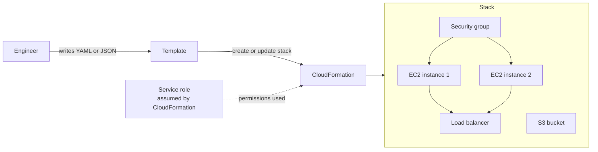
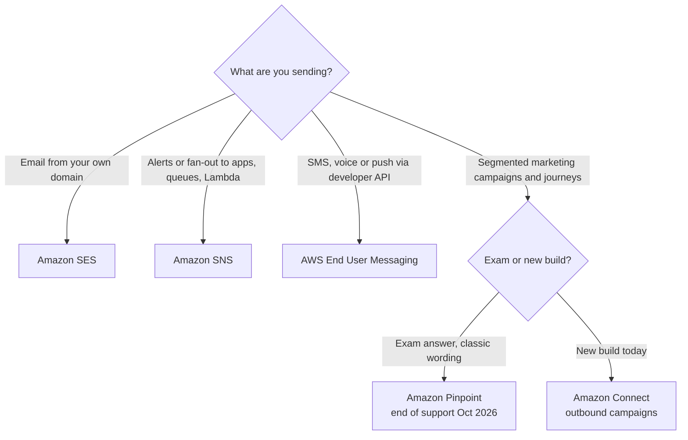
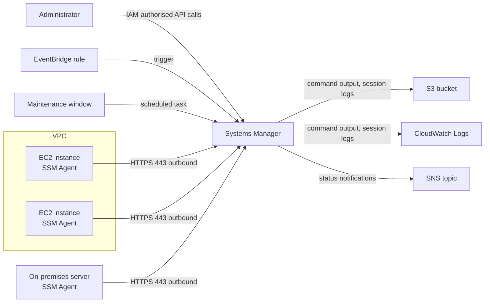
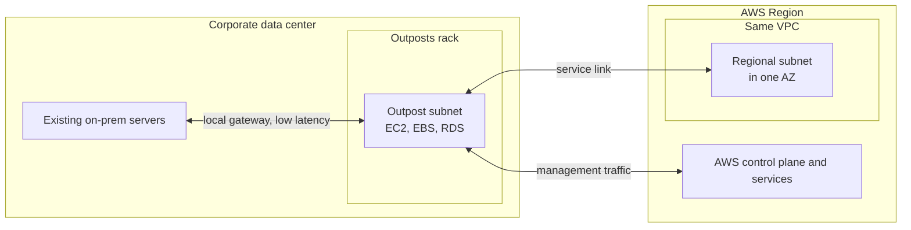
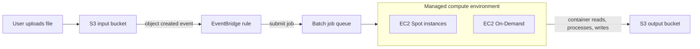

# Other Services

## Summary

This lesson collects the services that each earn only a handful of exam questions but are easy points once you know their one-line purpose. **AWS CloudFormation** turns a text template into a whole stack of resources (infrastructure as code), optionally acting through a **service role** so users need fewer permissions. **Amazon SES** sends and receives email at scale, while **Amazon Pinpoint** runs targeted multi-channel marketing campaigns (for existing customers only, until its end of support on 30 October 2026). **AWS Systems Manager** manages fleets of servers without SSH: **Session Manager** for shell access, **Run Command** for scripts, **Patch Manager** and **Maintenance Windows** for scheduled patching, **Automation** runbooks for routine fixes. **Cost Explorer** and **Cost Anomaly Detection** explain, forecast and watch your bill. **AWS Outposts** puts AWS-managed racks in your own data center, **AWS Batch** runs containerised jobs of any length on EC2, Spot or Fargate, **Amazon AppFlow** copies data out of SaaS apps such as Salesforce, **AWS Amplify** hosts and wires up full-stack web and mobile apps, and the **Instance Scheduler on AWS** solution stops idle EC2 and RDS resources outside business hours.

## Key concepts

- **CloudFormation**: a declarative template (YAML or JSON) describes resources; CloudFormation works out the order and creates them as one **stack**. Deleting the stack deletes everything it created.
- A **CloudFormation service role** is an IAM role that CloudFormation assumes for stack operations; the user only needs CloudFormation permissions plus **`iam:PassRole`** for that role.
- **Custom resources** (backed by a Lambda function or SNS topic) cover anything CloudFormation cannot create natively.
- **Amazon SES** = email (transactional, marketing, bulk) through the API or SMTP, with **DKIM**/**SPF** authentication, reputation metrics and shared, dedicated or bring-your-own IPs.
- **Amazon Pinpoint** = segments, templates, schedules and campaigns across email, SMS, push, voice and in-app; closed to new customers since 20 May 2025, with end of support on **30 October 2026**.
- **Systems Manager** needs the **SSM Agent** on each node plus an IAM identity; the agent calls out over HTTPS, so **no inbound ports** are required.
- **Session Manager**: browser or CLI shell to EC2 and on-premises servers with IAM-controlled access and session logs to S3 or CloudWatch Logs; no SSH keys, bastions or port 22.
- **Run Command**: run a document or command across many nodes (by tag, resource group or list) with rate control, output to S3/CloudWatch Logs and SNS status notifications.
- **Patch Manager** scans or installs OS and application patches against a **patch baseline**; **Maintenance Windows** schedule disruptive tasks; **Automation** runbooks fix or change AWS resources (restart, AMI, snapshot) and can be triggered by EventBridge, schedules or **AWS Config remediation**.
- **Cost Explorer**: graphs of cost and usage (13 months of history, 18-month forecast), resource-level and hourly views, and **Savings Plans** recommendations.
- **Cost Anomaly Detection**: machine learning learns your normal spend and alerts on spikes without you setting thresholds for "normal"; root-cause analysis; alerts by SNS or daily/weekly email.
- **Outposts** = AWS racks or servers installed on your premises for low latency, local processing and data residency; **you** handle physical security.
- **AWS Batch** = managed queue and scheduler for containerised jobs with no maximum run time; **Lambda** caps a run at 15 minutes.
- **AppFlow** = no-code transfers between SaaS apps and AWS on demand, on a schedule or on an event, optionally over **PrivateLink**.
- **Amplify** = tooling and hosting for full-stack web and mobile apps; **Instance Scheduler on AWS** = a CloudFormation-deployed solution (not a service) that stops and starts tagged resources on a schedule.

## AWS CloudFormation

### Infrastructure as code in one picture

With CloudFormation you stop clicking through consoles and instead write down **what** you want: "a security group, two EC2 instances that use it, an S3 bucket and a load balancer in front of the instances". You hand that file (the **template**) to CloudFormation, which figures out the dependencies (the security group must exist before the instances, the instances before they can be registered with the load balancer), creates everything in the right order and tracks the result as a single unit called a **stack**.

Because the template is declarative, you never write the orchestration logic yourself. If you change the template and update the stack, CloudFormation calculates the difference and changes only what is needed. If a step fails, it rolls the stack back to the last working state by default.

A template has a few main sections. Only `Resources` is required:

| Section | What goes in it | Example |
|---|---|---|
| `Parameters` | Values supplied at deploy time | Environment name, instance type |
| `Mappings` | Static lookup tables | AMI ID per Region |
| `Conditions` | Create something only when a test is true | Add a NAT gateway only in `prod` |
| `Resources` | The AWS resources to create (required) | `AWS::S3::Bucket`, `AWS::EC2::Instance` |
| `Outputs` | Values to show or export to other stacks | The load balancer DNS name |

### Why teams use it

- **Control and review.** Nothing is built by hand, so every change goes through the template, which lives in Git and is reviewed like application code. You can see who changed what and roll back to an older template.
- **Cost visibility.** CloudFormation adds stack-identifying tags (such as `aws:cloudformation:stack-name`) to most taggable resources it creates, so you can filter the bill by stack. A common saving trick: delete a development stack at 5 PM and recreate it from the same template at 8 AM, paying only for working hours.
- **Productivity and repeatability.** Tearing an environment down and rebuilding it becomes routine. The same template deploys an identical copy in another Region or account (StackSets automate this across many accounts and Regions).
- **Reuse.** Start from published templates and the extensive resource reference in the docs instead of reinventing patterns.
- **Coverage.** Almost every AWS resource type is supported, including everything in this course. For anything that is not, a **custom resource** sends a request to a Lambda function (or SNS topic) that you write; the function does the work and reports `SUCCESS` or `FAILED` back to CloudFormation. Typical uses: call a third-party API, empty an S3 bucket before deletion, look up a value at deploy time.

CloudFormation itself costs nothing for `AWS::*` resource types; you pay for the resources the stack creates. Third-party registry extensions and custom hooks are billed per handler operation beyond a monthly free allowance.

> [!UPDATED] Cost estimates now come from the AWS Pricing Calculator
> The slides say you can estimate a stack's cost from its template. The `estimate-template-cost` CLI command is still documented, but it returns a link to the AWS Simple Monthly Calculator, which AWS stopped supporting in 2023. Plan costs with the **AWS Pricing Calculator** instead, and use the stack tags in Cost Explorer for actual spend.

### Seeing a template as a diagram

A big template is hard to read as text. The slides show a WordPress stack opened in **AWS Infrastructure Composer**, which draws each resource as a card and connects the ones that reference each other (load balancer, target group, launch configuration, database), so you understand the architecture at a glance.

> [!UPDATED] Infrastructure Composer is being replaced in the console
> AWS announced end of support for Infrastructure Composer: it stops accepting new customers on 29 October 2026 and the standalone console shuts down on **7 December 2026**. The same drag-and-drop canvas stays available in the AWS Toolkit for Visual Studio Code. Inside the CloudFormation console, **template studio** now shows your template text beside a resource diagram that redraws as you edit; choose **Open in template studio** wherever a template is displayed. Existing stacks and templates are not affected.

### The service role: least privilege for stack operations

By default CloudFormation acts with the permissions of whoever starts the stack operation. That means a developer who deploys a stack containing an S3 bucket, a Lambda function and an IAM role needs permissions for all three services.

A **service role** changes this. You create an IAM role that trusts `cloudformation.amazonaws.com` and grant it exactly what the stack needs (for example, only S3 bucket actions). When a stack uses that role, CloudFormation makes every create, update and delete call with the role's credentials, not the user's.

The user then needs only:

- `cloudformation:*` (or a narrower set of stack actions), and
- `iam:PassRole` on that specific role, which is the permission to hand the role to an AWS service.

> [!EXAMPLE] Self-service buckets without S3 admin rights
> A platform team creates `cfn-s3-only-role` with S3 bucket permissions. Developers get CloudFormation permissions plus `iam:PassRole` for that role, but no direct S3 permissions. They can deploy approved templates that create buckets, yet they cannot create or delete buckets by hand, and a template that tries to create something else (say, an SNS topic) fails because the role lacks that permission.

> [!WARNING] A service role sticks to the stack
> Once a stack is created with a service role, CloudFormation uses it for every later operation. You can swap it for a different role when you update the stack, but you cannot remove it, so the stack never goes back to using the caller's own permissions. Anyone allowed to update that stack effectively uses the role's permissions, even without `iam:PassRole`. Keep the role's permissions tight, and do not delete the role while the stack still exists or the stack cannot be updated or deleted.

## Amazon SES and Amazon Pinpoint

### Amazon Simple Email Service (SES)

SES is a managed email platform. Your application sends mail through the **SES API** (or an AWS SDK) or through the standard **SMTP** interface, and SES handles the mail servers, scaling and IP reputation. It can also **receive** email: incoming messages can be stored in S3, passed to Lambda or announced on SNS, which is how teams build auto-responders or ticket systems from inbound mail.

What to remember:

- **Use cases**: transactional (order confirmations, password resets), marketing (newsletters, offers) and bulk email.
- **Authentication**: supports **DKIM** (Easy DKIM is simplest with Route 53) and **SPF**, which help receiving servers trust your mail.
- **Visibility**: sending statistics (deliveries, bounces, complaints from feedback loops, opens and clicks) and a reputation dashboard. **Virtual Deliverability Manager** adds deliverability insights and advice. Sending events can flow to CloudWatch, Data Firehose or SNS.
- **IP options**: shared IPs (default, managed by AWS), **dedicated IPs (standard)** that you warm up and manage, **dedicated IPs (managed)** that SES warms up and scales for you, and **bring your own IP (BYOIP)** for customer-owned ranges.

> [!NOTE] New accounts start in the SES sandbox
> In each Region a new SES account can send only to verified addresses (or the mailbox simulator), at most 200 messages per 24 hours and 1 message per second. Request production access to lift these limits. Even in production, every "From" identity (address or domain) must be verified.

### Amazon Pinpoint

Pinpoint is AWS's marketing communications service for existing customers until its end of support: two-way messaging over email, SMS, mobile push, voice and in-app messages, scaling to billions of messages a day. Its value was the **engagement layer** on top of the channels:

- **Segments** of customers built from attributes and behaviour, and personalised **message templates**.
- **Campaigns** and multi-step **journeys** with delivery schedules.
- Two-way messaging, so customers could reply (for example, "reply STOP" or a yes/no SMS).
- Event streaming (for example, SMS delivered or failed) to Kinesis Data Streams or Data Firehose for analytics.

The contrast with SNS and SES is the key exam point. With **SNS or SES you manage each message yourself**: who receives it, what it says and when it goes. With **Pinpoint you define segments, templates, schedules and whole campaigns**, and the service handles targeting and delivery.

> [!UPDATED] Amazon Pinpoint reaches end of support on 30 October 2026
> Pinpoint stopped accepting new customers on 20 May 2025, and after 30 October 2026 its console and engagement resources (endpoints, segments, campaigns, journeys, analytics) are no longer available. The channel APIs for SMS, MMS, voice, push and WhatsApp were renamed **AWS End User Messaging** in 2024 and continue. AWS recommends **Amazon Connect** outbound campaigns and Customer Profiles for segments, campaigns and journeys, **Amazon SES** for email (including the deliverability dashboard, now in SES Virtual Deliverability Manager) and **Amazon Kinesis** for event collection. Exam questions written earlier may still name Pinpoint as the answer for targeted marketing campaigns.

### Choosing a messaging service

| Need | Best fit | Why not the others |
|---|---|---|
| Password reset or order confirmation emails, branded HTML, DKIM | **SES** | SNS email is plain notification text to subscribed addresses, not app email |
| Notify many subscribers or systems of one event (pub/sub) | **SNS** | SES is email only and has no topic fan-out |
| Marketing campaign to a customer segment across SMS and email, with schedules | **Pinpoint** (exam) / **Connect outbound campaigns** (today) | SNS and SES make you build segmentation and scheduling yourself |
| One-time passcodes by SMS from code | **AWS End User Messaging** (formerly Pinpoint SMS) | Pinpoint engagement features are being retired |

## AWS Systems Manager

Systems Manager is a collection of tools for operating fleets of EC2 instances, on-premises servers and VMs (all called **managed nodes**). Five of its tools matter for this exam: Session Manager, Run Command, Patch Manager, Maintenance Windows and Automation.

### How a node becomes managed

Every node needs three things:

1. The **SSM Agent** installed and running (it comes preinstalled on Amazon Linux and many other AWS-provided AMIs).
2. **Permissions**: an instance profile with the `AmazonSSMManagedInstanceCore` managed policy, or the account-level **Default Host Management Configuration** (which needs IMDSv2). On-premises servers register through a hybrid activation and an IAM service role.
3. A **network path** from the agent to the Systems Manager endpoints over HTTPS (port 443): through an internet gateway or NAT, or privately through VPC interface endpoints (`ssm`, `ssmmessages`, and `ec2messages` for older agents).

The agent always opens the connection outbound, which is why no inbound security group rule is needed.

### Session Manager: shell access without SSH

Session Manager opens an interactive shell (bash or PowerShell) on a managed node from the console, the EC2 **Connect** button or the AWS CLI (`aws ssm start-session`, which needs the Session Manager plugin locally).

- **No inbound ports**: port 22 (SSH) and RDP can stay closed, and you need no bastion host and no SSH key pairs to rotate.
- **IAM controls access**: policies decide who can start sessions on which nodes, and access can be granted temporarily (for example, to the on-call engineer).
- **Auditing**: CloudTrail records who started each session; the session's commands and output can be logged to **S3** or **CloudWatch Logs**, optionally encrypted with KMS. EventBridge can notify you when sessions start or end.
- **Works on Linux, macOS and Windows**, on EC2 and on-premises nodes, and supports port forwarding (for example, reaching a private RDS database from your laptop through an instance).

> [!EXAMPLE] Replacing a bastion host
> A company keeps a bastion EC2 instance with port 22 open to the office IP range so admins can hop into private instances. Moving to Session Manager removes the bastion, closes port 22 everywhere, removes the shared key file, and adds per-user IAM control and full command logs in S3. The private instances only need outbound HTTPS to Systems Manager (via NAT or VPC endpoints).

### Run Command: scripts across a fleet

Run Command executes an **SSM document** (a predefined or custom script definition, such as `AWS-RunShellScript` or `AWS-RunPowerShellScript`) or a plain command on many nodes at once, without logging in to any of them.

- **Targets**: instance IDs, **tags** (for example `Environment=prod`) or **resource groups**.
- **Rate control**: how many nodes run at the same time (number or percentage) and an error threshold that stops the rollout.
- **Output**: shown in the console, written to an **S3** bucket or sent to **CloudWatch Logs**.
- **Notifications**: status changes (in progress, success, failed and so on) can go to **SNS**.
- **Integration**: IAM controls who can run which document, CloudTrail logs every invocation, and **EventBridge** can invoke Run Command as a rule target (for example, gather logs when an instance leaves an Auto Scaling group).

### Patch Manager and Maintenance Windows

**Patch Manager** automates patching of managed nodes: operating system updates, security fixes and, on Windows Server, Microsoft application updates. It works for EC2 and on-premises nodes running Linux, macOS or Windows Server.

- A **patch baseline** defines which patches are approved (for example, all `Security` patches classified `Critical` or `Important`, seven days after release). AWS provides predefined baselines; custom ones are recommended.
- A patching run is either **Scan** (report missing patches, the basis of a **compliance report**) or **Scan and install**. Under the hood both use the `AWS-RunPatchBaseline` document, run through Run Command.
- You can patch **on demand** ("Patch now") or **on a schedule** using a **maintenance window** or a Quick Setup **patch policy** (AWS's recommended method, which can span accounts and Regions of an organization).

A **maintenance window** defines when disruptive work is allowed on your nodes. It contains:

- a **schedule** (cron or rate expression, with a time zone),
- a maximum **duration** (and a cutoff before which no new tasks start),
- a set of registered **targets** (nodes or other resources), and
- a set of registered **tasks**: Run Command, Automation, Lambda or Step Functions.

> [!EXAMPLE] Nightly patching without a human awake
> A maintenance window opens every Sunday at 02:00 for three hours, targets instances tagged `PatchGroup=web`, and registers a Run Command task with `AWS-RunPatchBaseline` set to install and reboot if needed. On Monday morning the Patch Manager compliance view shows which nodes are still missing patches.

### Automation: runbooks for AWS resources

Run Command acts **inside** a node; **Automation** orchestrates actions **on AWS resources**, such as restarting instances, creating an AMI, taking an EBS snapshot or changing an RDS instance. The steps live in an **Automation runbook** (an SSM document of type `Automation`), either AWS-provided (`AWS-RestartEC2Instance`, `AWS-CreateImage`, `AWS-UpdateLinuxAmi`) or your own.

You can start a runbook:

- manually from the console, CLI or SDK,
- from an **EventBridge** rule,
- on a schedule as a **maintenance window** task, or
- as the **remediation** action of an **AWS Config** rule (for example, automatically re-enable encryption or close an open security group).

> [!UPDATED] Automation no longer has a free tier
> Automation is billed per step and per second of script execution. The free tier ended for new Automation customers on 14 August 2025 and for existing customers on 31 December 2025. Session Manager, Run Command, Patch Manager and Maintenance Windows remain free on EC2 instances.

> [!UPDATED] Systems Manager console and on-premises pricing changes
> Systems Manager now centres on a **unified console** (Explore nodes, node insights) and the Session Manager legacy page is scheduled for deprecation on 31 December 2026. On the pricing side, AWS removed the advanced instances tier on 30 June 2026; on-premises (hybrid) nodes register free, but Session Manager sessions and Run Command invocations on them are billed from 30 September 2026.

| Tool | Acts on | Typical trigger | Exam signal |
|---|---|---|---|
| Session Manager | One node, interactive | A person needs a shell | "No SSH, no bastion, no port 22, log every command" |
| Run Command | Many nodes, one-off script | Console, CLI, EventBridge | "Run a script on hundreds of instances without logging in" |
| Patch Manager | Nodes' OS and app packages | On demand, maintenance window, patch policy | "Report missing patches", "patch compliance" |
| Maintenance Windows | Schedules tasks for the others | Cron or rate schedule | "Only patch during an approved window" |
| Automation | AWS resources (EC2, AMI, EBS, RDS) | Console, EventBridge, schedule, Config remediation | "Automatically remediate a non-compliant resource" |

## Cost Explorer and Cost Anomaly Detection

### Cost Explorer

Cost Explorer turns your bill into interactive charts. You enable it once (the first visit to **Cost Explorer** in the Billing and Cost Management console) and it prepares your data within about a day.

- **Explore and report**: filter and group by service, account, Region, usage type or tag; save custom reports. See the big picture across all accounts of an organization, or drill into one service.
- **Granularity**: monthly and daily views over the **last 13 months** by default. Opt in to **multi-year data** (up to 38 months, monthly) and to **granular data** (hourly, and resource-level for the previous 14 days) when you need finer analysis.
- **Savings Plans and Reserved Instances recommendations**: based on 7, 30 or 60 days of past usage, Cost Explorer suggests a commitment (for example, "a 1-year Compute Savings Plan at USD 1.10 per hour") and estimates your monthly spend and savings if you buy it. Savings Plans are the more flexible alternative to Reserved Instances.
- **Forecasting**: pick a future date range to see projected spend for **up to 18 months**, shown with an 80% prediction interval.
- **Cost**: the console is free; each paginated Cost Explorer API request costs USD 0.01, and the opt-in hourly data is billed per usage record (USD 0.01 per 1,000 usage records a month).

> [!UPDATED] Natural-language questions in Cost Explorer
> Cost Explorer now lets you ask questions about your costs in plain language (**Ask question**, **Analyze with Amazon Q**) and receive explanations of trends, top drivers and forecasts. The core features above are unchanged.

> [!NOTE] Forecasts need an ungrouped chart
> The forecast ranges (+1M with daily granularity, +3M with daily or monthly, +18M with monthly) appear only when the chart is not grouped. Remove any **Group by** setting before choosing a future date range. Accounts with less than about one full billing cycle of history may get no forecast at all.

### Cost Anomaly Detection

AWS Budgets alert when spend crosses a number you choose. **Cost Anomaly Detection** works the other way round: machine learning models learn your normal pattern (including weekly and monthly seasonality and natural growth) and flag spend that does not fit, whether it is a one-time spike or a steady creep upwards. You do not have to guess what "normal" is.

- **Monitors** decide what is evaluated: all **AWS services**, member **accounts**, values of a **cost allocation tag**, or a **cost category**. AWS managed monitors track every value of a dimension automatically; customer managed monitors track up to 10 values you pick.
- **Alert subscriptions** decide who hears about it: **individual alerts** as soon as an anomaly is detected (requires an **SNS** topic, which can forward to Slack or Chime), or **daily** or **weekly summaries** by email. A threshold (absolute dollars or percentage of impact) filters which anomalies trigger alerts.
- **Root-cause analysis** ranks likely causes by dollar impact across service, account, Region and usage type.
- It runs about three times a day on Cost Explorer data, so detection can lag usage by up to 24 hours, and a newly used service needs about 10 days of history.
- It is free. When you enable Cost Explorer, AWS sets up an AWS services monitor and a daily summary subscription (alerts when an anomaly exceeds USD 100 **and** 40% of expected spend).

> [!EXAMPLE] A forgotten GPU instance
> An engineer launches a large GPU instance for a test and forgets it. Spend on EC2 jumps far above its usual pattern. Within a day, Cost Anomaly Detection flags an anomaly, names EC2 in `us-west-2` and the GPU usage type as the top root cause, and emails the finance team in the daily summary. A budget would only have fired once the monthly total crossed its threshold.

## AWS Outposts

Many companies run a **hybrid cloud**: some systems stay on premises (latency, data residency, migration in progress) while others run in AWS. That usually means two toolsets: the AWS console, CLI and APIs for the cloud, and a different stack for the data center.

**AWS Outposts** removes the split. AWS delivers and manages AWS hardware in your facility (AWS installs racks; you install the smaller servers yourself), and that capacity appears as an extension of an AWS Region: you create subnets on the Outpost inside your VPC and launch resources with the same console, APIs and tools.

- **Form factors**: **Outposts racks** (industry-standard 42U racks, for larger deployments) and **Outposts servers** (1U or 2U servers for sites with little space).
- **Services you can run locally** include EC2, EBS, S3 on Outposts, ECS, EKS nodes, RDS, ElastiCache, EMR and Application Load Balancers (racks support the widest set).
- **Benefits**: applications sit next to the on-premises systems they talk to (very low latency), data can be processed where it is produced, **data residency** rules are met because data stays in your building, migration becomes a gradual move rather than a big bang, and AWS still runs the infrastructure for you.
- **Shared responsibility**: AWS maintains the hardware and software; **you are responsible for the physical security**, power, networking and environment of the site.
- **Connectivity**: the Outpost connects back to its parent Region through a **service link**. Outposts are not designed for disconnected operation: if the link drops, running instances keep working locally, but control-plane actions such as launching or stopping instances may fail.

> [!TIP] Outposts versus Local Zones versus Wavelength
> Outposts = AWS hardware in **your** building. Local Zones = AWS-run infrastructure in a metro area near your users. Wavelength = AWS infrastructure inside telecom 5G networks. "Must stay in our own data center" or "data residency on premises" points to Outposts.

## AWS Batch

A **batch job** has a clear start and end (render a video, convert a million images, run a genomics pipeline), unlike a web server that runs continuously. **AWS Batch** is a fully managed batch computing service: you submit or schedule jobs, and Batch queues them, provisions the right amount of compute and memory, runs them and scales the capacity back down. It can handle hundreds of thousands of jobs.

- Jobs are packaged as **container images** and run on **Amazon ECS** or **Amazon EKS**, with capacity from **EC2 On-Demand**, **EC2 Spot**, **Fargate** or ECS Managed Instances.
- Core pieces: a **job definition** (image, vCPU, memory, IAM role), a **job queue** with priorities, and a **compute environment** (managed by Batch or by you). Jobs can depend on other jobs.
- There is **no additional charge** for Batch; you pay for the EC2, Spot or Fargate capacity it uses, so Spot capacity makes it very cost-effective.

### Batch versus Lambda

| | AWS Lambda | AWS Batch |
|---|---|---|
| Maximum run time | 15 minutes per invocation | No limit (you can set your own job timeout) |
| Runtime | Supported runtimes, custom runtimes or container images up to 10 GB | Anything you can package as a container image |
| Temporary disk | `/tmp` from 512 MB to 10,240 MB | EBS volumes or instance store on the EC2 hosts (Fargate gives ephemeral storage) |
| Infrastructure | Serverless, no instances to see | Runs on EC2 or Fargate capacity that Batch manages for you |
| Typical job | Short event handlers, API back ends | Long, heavy jobs: rendering, simulations, ETL, ML training |

> [!UPDATED] Lambda has longer-running options now
> Standard Lambda functions still stop at 15 minutes. Newer **Lambda Managed Instances** allow up to 90 minutes for asynchronous and event-source invocations, and **durable functions** checkpoint multi-step workflows so that a whole execution can span up to a year. For the exam, "job runs for hours" or "needs more than 15 minutes" still points to Batch (or ECS/Fargate), not Lambda.

## Amazon AppFlow

Many companies keep business data in SaaS tools: customer records in Salesforce, tickets in Zendesk or ServiceNow, chat in Slack, ERP data in SAP. **Amazon AppFlow** is a fully managed integration service that moves that data to AWS (and between SaaS apps) without custom API code.

- **Sources** include Salesforce, SAP, Zendesk, Slack, ServiceNow, Marketo, Google Analytics and Amazon S3; **destinations** include Amazon S3, Amazon Redshift, Snowflake and Salesforce.
- **Triggers**: run **on demand**, **on a schedule** (full or incremental transfers), or **on an event** from SaaS apps that publish change events.
- **Transformations** while copying: field mapping, filtering, validation, masking and partitioning of files written to S3 (optionally cataloguing them in the Glue Data Catalog).
- **Security**: encrypted in transit over the internet, or kept off the internet entirely through **AWS PrivateLink** for supported apps.
- **Pricing**: per successful flow run plus per GB processed, which suits recurring syncs.

> [!EXAMPLE] Salesforce opportunities into Redshift
> Sales wants a daily dashboard that joins Salesforce opportunities with billing data in Redshift. An AppFlow flow runs every night, pulls only records changed since the last run, drops test accounts with a filter, and loads the rest into Redshift, all configured in the console with no Lambda code to maintain.

## AWS Amplify

**AWS Amplify** is a set of tools and services for building and deploying full-stack web and mobile apps. Think of it as "Elastic Beanstalk for web and mobile apps": it gives front-end developers authentication, storage, APIs (REST and GraphQL), real-time pub/sub, analytics, AI/ML features and monitoring without wiring each AWS service by hand.

- **Backend**: you describe features (auth, data, storage) and Amplify provisions services such as **Cognito**, **AppSync** or **API Gateway**, **DynamoDB**, **Lambda** and **S3**.
- **Frontend libraries** connect web (React, Next.js, Angular, Vue) and mobile apps to that backend.
- **Amplify Hosting** provides Git-based CI/CD: connect a repository from GitHub, Bitbucket, GitLab or AWS CodeCommit (or upload files), and every push builds and deploys to a global CDN (**CloudFront**), with feature-branch environments, pull-request previews and custom domains.

> [!UPDATED] Amplify Gen 2 is code-first
> The slides show the Amplify CLI configuring the backend (now called Gen 1). **Amplify Gen 2** defines the backend in TypeScript code instead, and the former "Amplify Console" is now **Amplify Hosting**. The exam signal is unchanged: a full-stack web or mobile app with managed auth, APIs and hosting points to Amplify.

## Instance Scheduler on AWS

Development and test environments often sit idle for nights and weekends. The **Instance Scheduler on AWS** is an **AWS Solution** (a reference implementation you deploy with a CloudFormation template), not a managed service.

- It **stops and starts** resources on schedules you define, for example "run 08:00 to 18:00, Monday to Friday". Running 50 hours instead of 168 a week saves up to about 70% on those resources.
- **Supported**: EC2 instances, EC2 Auto Scaling groups (by setting capacity to zero), RDS instances, Aurora clusters, Neptune and DocumentDB {{updated: The slides list EC2, Auto Scaling groups and RDS; the current version also schedules Aurora clusters, Neptune and DocumentDB}}. Databases are stopped, never deleted.
- **How it works**: schedules and periods live in a **DynamoDB** table; you **tag** resources with the schedule name; **Lambda** functions triggered on a timer apply start and stop actions.
- Works **across accounts and Regions** from one deployment.
- The solution's own resources cost money too (AWS estimates about USD 13 per month in us-east-1), which is small next to the instance savings.

> [!TIP] Scheduler versus Auto Scaling scheduled actions
> An Auto Scaling group's scheduled actions only resize that group. Instance Scheduler covers stand-alone EC2 instances and RDS databases as well, across many accounts, from one place.

## Exam tips

> [!EXAM] Infrastructure as code
> "Repeatable environments", "recreate the stack in another Region", "review infrastructure changes in code" → **CloudFormation**. "Let developers deploy stacks without broad permissions" → a **CloudFormation service role** plus `iam:PassRole` for the developers.

> [!EXAM] Email versus campaigns
> "Send transactional or bulk email with DKIM/SPF" → **SES**. "Targeted marketing campaigns to customer segments over SMS, email and push, with schedules and templates" → **Pinpoint** in classic questions (Amazon Connect outbound campaigns today).

> [!EXAM] Server access and operations
> "No SSH, no bastion host, no open port 22, audit every command" → **Session Manager**. "Run a script on many instances" → **Run Command**. "Patch on a schedule and report compliance" → **Patch Manager + Maintenance Windows**. "Automatically remediate a Config rule violation" or "restart instances / create AMIs on events" → **Systems Manager Automation**.

> [!EXAM] Cost tools
> "Visualise and forecast spend, choose a Savings Plan" → **Cost Explorer**. "Detect unusual spend automatically, without setting thresholds" → **Cost Anomaly Detection**. "Stop dev instances outside business hours" → **Instance Scheduler on AWS**.

> [!EXAM] Compute edge cases
> "AWS services on premises / in our own data center / data residency with low latency" → **Outposts**. "Jobs run for hours", "containerised batch jobs on Spot" → **AWS Batch**. "Copy Salesforce or ServiceNow data into S3 or Redshift without code" → **AppFlow**. "Full-stack web or mobile app with hosting, auth and CI/CD" → **Amplify**.

## Common traps

> [!TRAP] Lambda for long jobs
> A job that runs for 40 minutes or several hours does not fit standard Lambda (15-minute maximum). Choose AWS Batch (or ECS/Fargate), not Lambda with "a higher timeout".

> [!TRAP] Opening port 22 "just for Session Manager"
> Session Manager needs no inbound rule at all. It needs the SSM Agent, an IAM permission for the instance and outbound HTTPS to Systems Manager (internet, NAT or VPC endpoints). An answer that opens port 22 or adds a bastion misses the point.

> [!TRAP] Run Command versus Automation
> Run Command executes scripts **inside** the operating system of managed nodes. Automation runs multi-step runbooks against **AWS APIs** (stop/start, AMI, snapshot, RDS). Config remediation uses Automation runbooks, not Run Command directly.

> [!TRAP] SNS for marketing email
> SNS email subscriptions are for notifications to people who confirmed the subscription; they are not a way to send branded transactional or marketing email to customers. That is SES (or Pinpoint campaigns).

> [!TRAP] Cost Anomaly Detection versus AWS Budgets
> Budgets alert on a fixed threshold you set (forecast or actual). Cost Anomaly Detection learns your pattern with machine learning and needs no "normal spend" threshold. When the question says "without defining thresholds" or "unusual spend", pick Anomaly Detection.

> [!TRAP] Outposts physical security
> AWS manages the Outposts hardware and software, but the rack sits in your building. Physical security and site requirements are the customer's job.

> [!TRAP] Instance Scheduler is not a service
> It is an AWS Solution deployed through CloudFormation (Lambda + DynamoDB + tags). There is no "Instance Scheduler" console to enable.
