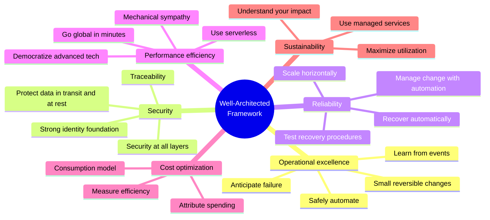
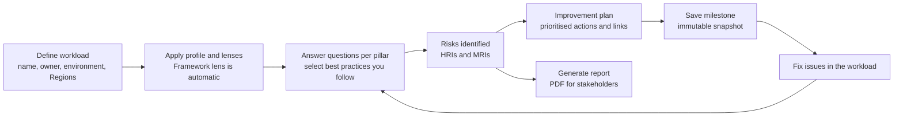
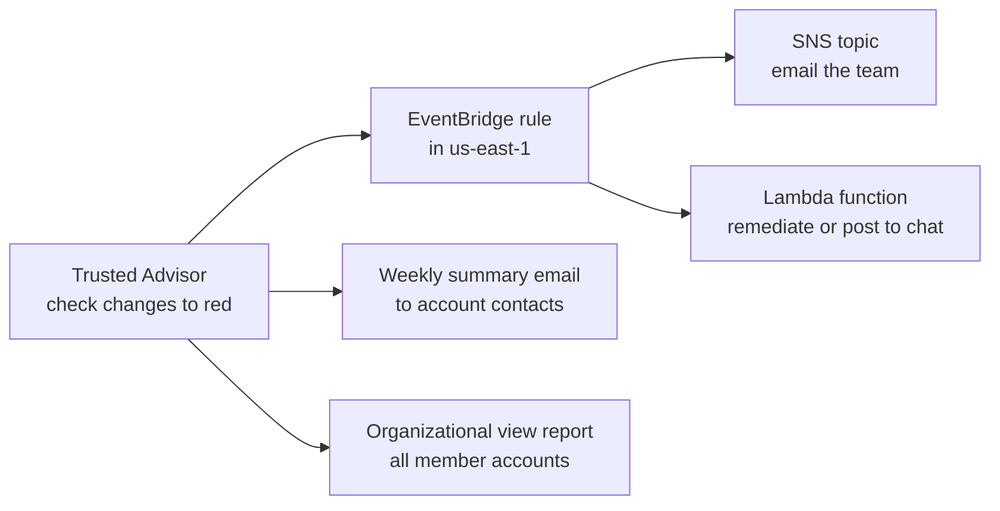
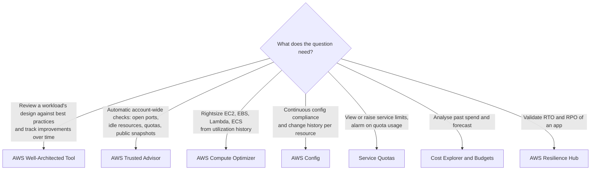
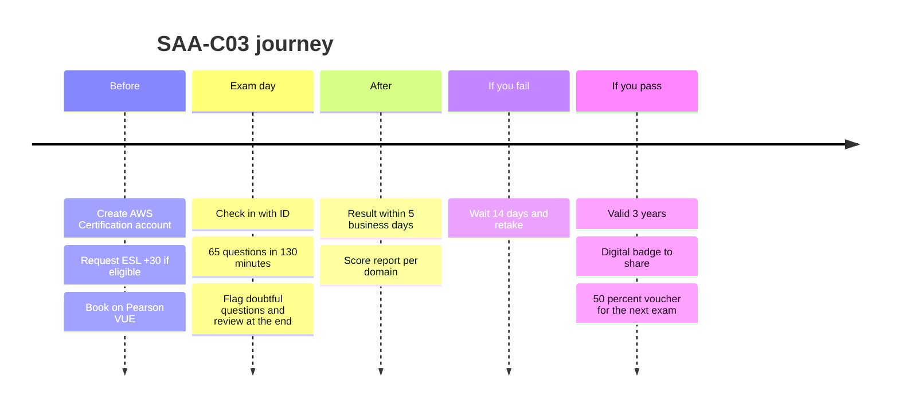
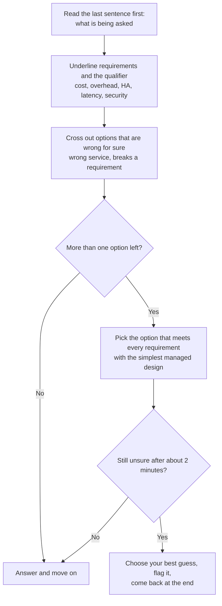

# Well-Architected & Exam Preparation

## Summary

This final lesson ties the course together. The **AWS Well-Architected Framework** is the yardstick AWS uses to judge an architecture: six general design principles plus six pillars (operational excellence, security, reliability, performance efficiency, cost optimization, sustainability), each with its own design principles and best practices. SAA-C03 is explicitly built on it, so every scenario question is really asking "which option is most well-architected for this requirement?". The free **AWS Well-Architected Tool** turns the framework into a guided questionnaire for one workload and produces high and medium risks, an improvement plan and milestones. **AWS Trusted Advisor** works the other way round: it scans your account automatically and flags concrete problems (open ports, idle resources, quotas close to their limit), with the full check set unlocked by a paid support plan. The second half covers where to find more reference architectures and whitepapers, how the exam itself works (65 questions in 130 minutes, scaled pass mark 720), a keyword-driven elimination strategy, and where SAA fits among the other AWS certifications.

## Key concepts

- The **Well-Architected Framework** = general design principles + **six pillars**: operational excellence, security, reliability, performance efficiency, cost optimization, **sustainability** (added in 2021).
- **General design principles**: stop guessing capacity, test at production scale, automate to experiment, evolve the architecture, decide with data, practise with **game days**.
- Each pillar has its own **design principles** and **best practice areas**; exam answers usually line up with them (for example "scale horizontally" for reliability, "adopt a consumption model" for cost).
- Pillars involve **trade-offs** driven by business context (for example cheaper but less redundant dev environments), but **security and operational excellence are generally not traded away**.
- **Sustainability is a shared responsibility**: AWS handles sustainability *of* the cloud, you handle sustainability *in* the cloud (right-sizing, high utilization, managed services).
- The **AWS Well-Architected Tool** is free: define a **workload**, answer the questions per pillar, get **high risk issues (HRIs)** and **medium risk issues (MRIs)**, an **improvement plan**, reports and immutable **milestones**.
- **Lenses** extend the review for specific workload types (Serverless, SaaS, Generative AI, Machine Learning, IoT and more); you can also write **custom lenses**.
- **AWS Trusted Advisor** inspects an account and recommends fixes in six categories: security, fault tolerance, cost optimization, performance, operational excellence and **service limits** (quotas).
- With **Basic Support** you get all service limits checks and a handful of core security and fault tolerance checks; the **full check set, the Trusted Advisor API, the AWS Support API and EventBridge rules** need **Business Support+, Enterprise Support or Unified Operations**.
- Reference material: the **AWS Architecture Center**, the **AWS Solutions Library**, the Well-Architected and **Disaster Recovery** whitepapers, and each service's **FAQ**.
- **SAA-C03**: 65 questions (50 scored, 15 unscored), 130 minutes, USD 150, scaled score 100 to 1,000, **pass at 720**, compensatory scoring, results within 5 business days, retake after **14 days**, valid **3 years**.
- **Exam technique**: eliminate the options you know are wrong, then pick the one that meets *every* stated requirement with the least complexity; the qualifier ("most cost-effective", "least operational overhead") decides between workable answers.

## The AWS Well-Architected Framework

AWS solutions architects reviewed thousands of customer systems and wrote down what the good ones had in common. The result is the Well-Architected Framework: a set of principles, questions and best practices you can measure any workload against. AWS describes a review as a constructive conversation, not an audit. The goal is to find risks early and fix them on purpose, instead of discovering them during an outage or a surprising bill.

A few terms the framework uses throughout:

- A **component** is code, configuration and AWS resources that together meet one requirement (for example "the checkout API").
- A **workload** is a set of components that deliver business value together (for example "the online store"). Reviews happen at workload level.
- A **milestone** marks a key moment in the workload's life (design, testing, go-live, production).
- The **technology portfolio** is the collection of workloads a business depends on.

> [!NOTE] The framework keeps changing
> The framework is a living document. The current major revision is dated 6 November 2024 (reliability received a large refresh, and security and operational excellence gained generative AI guidance). You do not need revision dates for the exam, but it explains why the pillar wording below sometimes differs from older study material.

### General design principles

These six principles describe what the cloud lets you do that a traditional data center does not. Each one maps to features you have already met in this course.

| Principle | What it means in practice | AWS example |
|---|---|---|
| **Stop guessing your capacity needs** | Provision for today's load and let the platform grow or shrink with demand, instead of buying for a guessed peak | EC2 Auto Scaling, Lambda, DynamoDB on-demand |
| **Test systems at production scale** | Spin up a full-size copy of production for a load test, then delete it; you pay only for the hours it ran | CloudFormation stack in a test account, deleted afterwards |
| **Automate with architectural experimentation in mind** | Infrastructure as code makes environments cheap to create, compare, audit and roll back | CloudFormation, CDK, CodePipeline |
| **Consider evolutionary architectures** | Design decisions are not one-off events; automation and on-demand testing make it safe to change the design as the business changes | Moving from EC2 to containers or Lambda one service at a time |
| **Drive architectures using data** | Measure how design choices affect behaviour and cost, and decide on facts | CloudWatch metrics, X-Ray traces, Cost Explorer |
| **Improve through game days** | Rehearse failures and peak events (a regional outage, a flash sale) in a scheduled exercise to find weak spots and train the team | AWS Fault Injection Service experiments, load tests before a big sale |

> [!UPDATED] Principle names reworded in the current framework
> The current framework titles two principles slightly differently from older material: "Automate with architectural experimentation in mind" and "Consider evolutionary architectures". The ideas are unchanged. The framework has no separate flash-sale item: its game-day principle talks about simulating production events in general, and rehearsing a flash sale is simply one such event.

### The six pillars

| Pillar | The question it asks | Best practice areas | Services you will see in answers |
|---|---|---|---|
| **Operational excellence** | Can we run, monitor and keep improving this workload so it delivers business value? | Organization, prepare, operate, evolve | CloudFormation, Systems Manager, CloudWatch, X-Ray, CodePipeline, Config |
| **Security** | Are data, systems and assets protected, and can we prove it? | Security foundations, identity and access management, detection, infrastructure protection, data protection, incident response, application security | IAM, Identity Center, Organizations and SCPs, KMS, Secrets Manager, WAF, Shield, GuardDuty, CloudTrail, Security Hub |
| **Reliability** | Does it do its job correctly and consistently, and recover when something breaks? | Foundations, workload architecture, change management, failure management | Multi-AZ RDS and Aurora, Auto Scaling, ELB, Route 53 health checks, SQS, AWS Backup, Service Quotas |
| **Performance efficiency** | Are we using the right resources to meet requirements, and staying efficient as demand and technology change? | Architecture selection, compute and hardware, data management, networking and content delivery, process and culture | Right instance families, Lambda, ElastiCache, DynamoDB with DAX, CloudFront, Global Accelerator |
| **Cost optimization** | Are we delivering business value at the lowest price point? | Cloud financial management, expenditure and usage awareness, cost-effective resources, managing demand and supply, optimizing over time | Savings Plans, Reserved and Spot Instances, S3 storage classes and lifecycle, Cost Explorer, Budgets, Compute Optimizer |
| **Sustainability** | Are we minimising the energy and resources this workload needs? | Region selection, alignment to demand, software and architecture, data management, hardware and services, process and culture | Graviton instances, Auto Scaling, serverless, S3 lifecycle to colder tiers, managed services |

### Operational excellence

Operational excellence is about how the team builds, ships and runs the workload. Its design principles, in short:

- **Organize teams around business outcomes** and align their goals and KPIs with what the business needs.
- **Implement observability**: collect the telemetry (metrics, logs, traces) that tells you when business outcomes are at risk, then act on it.
- **Safely automate where possible**: treat the whole environment, including runbooks, as code, with guardrails such as rate limits, error thresholds and approvals.
- **Make frequent, small, reversible changes** so a bad deployment has a small blast radius and is easy to roll back.
- **Refine operations procedures frequently** and check that the team actually knows them.
- **Anticipate failure** by running failure scenarios before real incidents.
- **Learn from all operational events** and share the lessons across teams.
- **Use managed services** to shrink the operational burden.

> [!EXAMPLE] Operational excellence in an exam scenario
> "Deployments occasionally break production and take hours to roll back." The well-architected direction is infrastructure as code plus a pipeline that ships small changes with automatic rollback (CodeDeploy blue/green or canary), not "add a manual approval checklist".

### Security

- **Implement a strong identity foundation**: least privilege, separation of duties, centralised identity, and no long-lived static credentials (roles and temporary credentials instead of access keys).
- **Maintain traceability**: log and audit every action and change in real time (CloudTrail, Config, CloudWatch) and automate the response.
- **Apply security at all layers**: defence in depth across the edge, VPC, load balancer, instance, operating system, application and code.
- **Automate security best practices**: security controls defined as code in version-controlled templates.
- **Protect data in transit and at rest**: classify data, then encrypt, tokenise and restrict access accordingly.
- **Keep people away from data**: replace direct human access and manual processing with tools, to cut mishandling and human error.
- **Prepare for security events**: have an incident response process, run simulations and automate detection and recovery.

### Reliability

- **Automatically recover from failure**: watch KPIs that reflect business value and trigger automated recovery when a threshold is breached.
- **Test recovery procedures**: in the cloud you can simulate failures and prove that the recovery actually works.
- **Scale horizontally to increase aggregate availability**: replace one big resource with several small ones so a single failure takes out only a fraction of capacity.
- **Stop guessing capacity**: monitor demand and add or remove resources automatically, keeping in mind that service quotas still apply.
- **Manage change through automation**: infrastructure changes go through automation that can be tracked and reviewed.

### Performance efficiency

- **Democratize advanced technologies**: consume hard technology (NoSQL, media transcoding, machine learning) as a managed service instead of building in-house expertise.
- **Go global in minutes**: deploy in several Regions or use the edge network to cut latency for users worldwide.
- **Use serverless architectures**: no servers to run, and managed services scale for you.
- **Experiment more often**: compare instance types, storage or configurations quickly because resources are virtual.
- **Consider mechanical sympathy**: choose the technology that fits how the workload uses it, for example pick a database by its data access pattern.

### Cost optimization

- **Implement cloud financial management**: build a cost capability (people, processes, tools) the same way you build a security capability.
- **Adopt a consumption model**: pay for what you use and scale with demand. AWS's own example: dev and test environments used 8 hours a day on weekdays can be stopped the rest of the time, about 75 % less (40 of 168 hours).
- **Measure overall efficiency**: compare business output with the cost of delivering it.
- **Stop spending money on undifferentiated heavy lifting**: let AWS rack servers and patch managed services.
- **Analyze and attribute expenditure**: tag and allocate costs to workload owners so they can see their ROI and optimise.

### Sustainability

- **Understand your impact** and **establish sustainability goals** (for example compute per transaction).
- **Maximize utilization**: AWS's example is that two hosts at 30 % utilization waste more energy than one host at 60 %, because each host has a baseline power draw.
- **Anticipate and adopt new, more efficient hardware and software offerings** (for example newer Graviton generations).
- **Use managed services**, which share infrastructure across many customers (Fargate, S3 Lifecycle to cold storage, Auto Scaling).
- **Reduce the downstream impact** of your workload on customers' devices.

> [!TIP] Sustainability shared responsibility
> Like security, sustainability is split. AWS is responsible for the sustainability **of** the cloud (efficient data centers, renewable energy, water stewardship). You are responsible for sustainability **in** the cloud: right-sizing, high utilization, deleting idle resources, choosing efficient Regions and instance types, and storing less data for less time.

### Trade-offs between pillars

The pillars reinforce each other most of the time: automation (operational excellence) also improves reliability and security, and right-sizing (cost) also helps sustainability. Still, real designs make choices based on business context.

| Situation | Typical choice | Pillar given more weight |
|---|---|---|
| Development or test environment | Single AZ, smaller instances, stopped at night | Cost and sustainability over reliability |
| Mission-critical payment system | Multi-AZ or multi-Region, extra capacity | Reliability over cost |
| E-commerce storefront | Caching, CDN, faster instances | Performance, because latency costs sales |
| Any workload | Encryption, least privilege, automated operations | Security and operational excellence are not traded away |

> [!UPDATED] Pillars and trade-offs
> Older course material says the pillars are a synergy rather than something to trade off. The current framework text says you do make trade-offs between pillars based on business context (its examples: lower cost and impact at the expense of reliability in development, more reliability at higher cost for mission-critical systems), while security and operational excellence are generally not traded off. For the exam: never pick an answer that weakens security to save money.

### Lenses

The framework questions are generic. A **lens** adds questions and best practices for a specific kind of workload or industry. The AWS Well-Architected Framework lens is applied to every workload automatically; you can add more from the **Lens Catalog**, for example Serverless Applications, SaaS, Generative AI, Machine Learning, Data Analytics, IoT, Container Build, DevOps, Migration, SAP, Financial Services, Healthcare and Government. Organisations can also write **custom lenses** for their own standards and share them with other accounts.

## AWS Well-Architected Tool

The **AWS Well-Architected Tool** (AWS WA Tool) is the framework as a console service. It costs nothing; you pay only for the resources your workloads use. It does not scan your resources by itself: it is a structured self-assessment that you (ideally the workload team, often with an AWS solutions architect or partner) fill in.

How a review works:

1. **Define a workload**: name, description, review owner, environment (**Production** or **Pre-production**) and the AWS Regions (or non-AWS locations) where it runs. Optional fields include account IDs, an architecture diagram URL, an AppRegistry application, industry, Trusted Advisor activation, Jira sync and tags.
2. Optionally attach a **profile** (business-context answers that mark which questions and risks are **prioritized** for you) and choose **lenses** (up to 20 per workload).
3. **Answer the questions** pillar by pillar. For each question you tick the best practices you already follow, choose **None of these**, mark the question as not applicable, or mark individual best practices as not applicable with a reason. **Info** opens guidance; **Ask an expert** links to the AWS re:Post community.
4. The tool computes risk per question: **high risk issues (HRIs)** are choices AWS has found can significantly hurt the business; **medium risk issues (MRIs)** hurt it to a lesser extent.
5. The **improvement plan** lists the risky questions with recommended actions and links to documentation and videos. A **dashboard** shows risks across workloads and pillars.
6. **Save a milestone** after the first full review and again after each round of fixes. Milestones cannot be edited, so they show progress over time.
7. **Generate report** produces a PDF with answers, notes and risk counts for people who do not use the tool.

Useful extras for teams: workloads, lenses, profiles and review templates can be **shared** with other accounts or an AWS Organizations organization; **review templates** pre-fill common answers for many similar workloads; **Trusted Advisor integration** shows related check results next to the questions; a **Jira connector** turns improvement items into tickets; EventBridge receives WA Tool events.

> [!EXAMPLE] A typical first review
> A startup defines "Mobile backend (prod)" in `eu-west-1`, answers the security questions and selects "None of these" for the question about how it manages credentials, because developers still use long-lived access keys. The tool raises an HRI and the improvement plan points to IAM Identity Center and IAM roles. The team saves milestone "baseline", fixes the issue, re-answers the question and saves milestone "after-identity-fix": the risk count drops and the history proves it.

> [!UPDATED] AI-powered Well-Architected Agent (preview)
> AWS now offers the **AWS Well-Architected Agent** in preview next to the WA Tool. Instead of a manual questionnaire it analyses deployed resources (refreshed weekly) and, on demand, IaC templates across cost, security, resilience and performance, then produces prioritised recommendations with ready-to-deploy fixes such as updated IaC code. It requires a Business Support+ or higher support plan; Developer and Business plans get no access. An agent profile is hosted in US East (N. Virginia), US East (Ohio) or US West (Oregon), yet it can scan resources in every commercial Region and in up to 100 accounts. Preview features can change before general availability, and SAA-C03 questions about "reviewing a workload against the Well-Architected Framework" still point to the **Well-Architected Tool**.

## AWS Trusted Advisor

**AWS Trusted Advisor** needs no agent or setup: it looks at the configuration and usage of your account and compares it with best practices AWS learned from many customers. Results are colour coded: **red** (action recommended), **yellow** (investigation recommended), **green** (no problem detected), and grey for checks with excluded items.

| Category | What it looks for | Example checks |
|---|---|---|
| **Cost optimization** | Money you are wasting | Idle load balancers, low-utilization EC2 instances, unassociated Elastic IP addresses, underutilized EBS volumes, Savings Plans purchase recommendations |
| **Performance** | Speed and responsiveness | Under-provisioned EBS volumes or Lambda memory, DynamoDB auto scaling not enabled |
| **Security** | Security gaps | Security groups with risky ports open to `0.0.0.0/0`, root account without MFA, public EBS or RDS snapshots, S3 bucket permissions |
| **Fault tolerance** | Missing redundancy | RDS instances without Multi-AZ, EBS volumes without recent snapshots, Auto Scaling groups or ALBs in a single AZ |
| **Service limits** | Usage approaching a quota: yellow at 80 % of the limit, red at 100 % | VPCs, Elastic IP addresses, EC2 On-Demand Instances, IAM roles, RDS DB instances |
| **Operational excellence** | Running the environment well at scale | VPCs without flow logs, load balancers without access logs, CloudTrail not sending to CloudWatch Logs |

### What your support plan unlocks

Trusted Advisor is where support plans matter on the exam.

| Capability | Basic Support (free) | Business Support+, Enterprise Support, Unified Operations |
|---|---|---|
| Service limits checks | All | All |
| Security and fault tolerance checks | A small core set (see below) | Full set |
| Cost optimization, performance, operational excellence checks | No | Yes (more than 500 checks in total) |
| Automatic refresh | No: refresh manually in the console | Weekly automatic refresh |
| Trusted Advisor API and AWS Support API | No | Yes |
| EventBridge rules on check status changes | No | Yes |
| Organizational view (all accounts in an organization) | No | Yes (plan on the management account) |
| Trusted Advisor Priority (account team prioritises findings) | No | Enterprise Support and Unified Operations only |

The core checks available to everyone are: **Amazon EBS Public Snapshots**, **Amazon RDS Public Snapshots**, **Amazon S3 Bucket Permissions**, **MFA on root account**, **Security Groups - Specific Ports Unrestricted**, and **AWS STS global endpoint usage across AWS Regions**, plus every **service limits** check.

> [!UPDATED] New support plans and who gets the full Trusted Advisor
> The slides tie the full check set and programmatic access to the Business and Enterprise plans. AWS has since reorganised support: the current plans are **Basic**, **Business Support+** (from USD 29 per month per account), **Enterprise Support** (minimum lowered to USD 5,000 per month) and **Unified Operations** (from USD 50,000 per month). Developer Support, Business Support and Enterprise On-Ramp are discontinued on 1 January 2027 (they remain in AWS GovCloud (US)). Existing customers on those plans keep them until then; Enterprise On-Ramp customers are being moved to Enterprise Support during 2026. The full check set, the Trusted Advisor API and the Support API now list Business Support+, Enterprise Support and Unified Operations.

> [!UPDATED] Two APIs, not one
> The slides mention programmatic access through the AWS Support API. There is now also a dedicated **Trusted Advisor API** (`aws trustedadvisor list-checks`, `list-recommendations`, `get-recommendation`) for checks, recommendations and affected resources; its organization-wide calls work only for recommendations managed by Trusted Advisor Priority. Both APIs need Business Support+ or higher. The Support API's Trusted Advisor operations still work but must use the US East (N. Virginia) endpoint.

### Automating on Trusted Advisor results

- **EventBridge**: Trusted Advisor is a global service, so its events arrive in **US East (N. Virginia)**. A rule there can notify an SNS topic or run a Lambda function when a check changes status (best-effort delivery, paid plans only).
- **Weekly email**: under **Preferences** → **Notifications** you choose which account contacts receive the weekly summary.
- **Organizational view**: with all features enabled in AWS Organizations, trusted access turned on and a Business Support+ or higher plan on the management account, that account can build reports (JSON or CSV) covering every member account. Each member account still sees only the checks its own plan includes.
- **Integrations**: some checks are powered by AWS Config, Security Hub controls can appear in Trusted Advisor, and Compute Optimizer can feed rightsizing checks.

### Which tool answers which question?

| Need | Best fit | Why not the others |
|---|---|---|
| Structured architecture review with HRIs, MRIs and milestones | Well-Architected Tool | Trusted Advisor does not ask about processes or design intent |
| Quick account health check with no setup | Trusted Advisor | WA Tool needs a person to answer questions |
| Is any security group exposing SSH or RDP to the internet? | Trusted Advisor (free core check) | Config can do it too, but needs rules set up |
| Are we close to a service quota? | Trusted Advisor service limits checks or Service Quotas with CloudWatch alarms | Cost Explorer shows spend, not limits |
| Right instance size from utilization history | Compute Optimizer | Trusted Advisor's low-utilization check only flags candidates |
| Prove a setting stayed compliant over time | AWS Config | Trusted Advisor shows current results and 30 days of status changes, not a configuration history per resource |

## Reference architectures and whitepapers

This course covered the patterns that appear most often on the exam: the classic tier (EC2, ELB, Auto Scaling, RDS, ElastiCache) and the serverless stack (S3, CloudFront, API Gateway, Lambda, DynamoDB). When you need more, AWS publishes vetted designs:

| Resource | What you find there | When to use it |
|---|---|---|
| **AWS Architecture Center** (`aws.amazon.com/architecture`) | Reference architecture diagrams, decision guides (which database, which container service), Well-Architected material, whitepapers, the Architecture Blog | Starting a design or comparing services |
| **AWS Solutions Library** (`aws.amazon.com/solutions`) | **AWS Solutions** (deployable implementations with code), **Guidance** (architecture plus sample code for a use case), partner solutions | You want something you can deploy or adapt quickly |
| **AWS Prescriptive Guidance** | Strategies, guides and patterns, especially for migration and modernisation | Planning a migration or a large change |
| **Well-Architected Framework and pillar whitepapers** | The full best practices behind the six pillars | Deepening any pillar |
| **Disaster Recovery of Workloads on AWS** whitepaper | RTO and RPO, the four DR strategies, testing DR | Any DR question (see lesson 33) |
| **Service FAQs** (for example the VPC FAQ) | Limits, behaviours and edge cases explained in Q&A form | Confirming details before the exam |

The DR whitepaper's four strategies, from cheapest and slowest to most expensive and fastest, are worth a last recap:

| Strategy | Idea | RTO / RPO |
|---|---|---|
| Backup and restore | Back up data (and infrastructure as code) to another Region; rebuild after a disaster | Hours |
| Pilot light | Core data replicated live; the rest of the stack is defined but off until needed | Tens of minutes |
| Warm standby | A scaled-down but fully working copy runs all the time and scales up on failover | Minutes |
| Multi-site active/active | Full capacity in several Regions serving traffic at once | Near zero |

> [!UPDATED] "Architecting for the Cloud" is archived
> The slides recommend the "Architecting for the Cloud: AWS Best Practices" whitepaper. AWS has archived it (last version October 2018) and points readers to the **AWS Well-Architected Framework** instead. Read the framework and the DR whitepaper; skip the archived paper.

## Exam preparation

### How the exam works

| Item | SAA-C03 today |
|---|---|
| Questions | 65 in total: **50 scored** and **15 unscored** trial questions you cannot tell apart |
| Time | **130 minutes** (non-native English speakers can request an **ESL +30 minutes** accommodation once, and it applies to all later exams) |
| Question types | Multiple choice (one correct of four) and multiple response (two or more correct of five or more) |
| Fee | USD 150 |
| Scoring | Scaled score from 100 to 1,000; **720 to pass**; compensatory, so you need only the overall score, not a pass in each domain |
| Unanswered questions | Count as wrong; there is **no penalty for guessing** |
| Delivery | Pearson VUE test center or online proctored (OnVUE) |
| Exam-day rules | No notes or personal items: belongings are stored before you start. At a test center you may take an unscheduled break, but the clock keeps running; online you must stay in camera view for the whole exam, with no breaks |
| During the exam | **Flag for review** marks a question; a review screen at the end lists all, incomplete or flagged questions before you submit |
| Results | Within **5 business days** in your AWS Certification account; the score report may show performance per domain but never which questions you missed |
| Retake | Wait **14 calendar days** after a fail; each attempt is paid |
| Validity | **3 years**, then recertify; certified people get a 50 % discount voucher for another exam or recertification |
| Recommended experience | At least one year of hands-on experience designing solutions on AWS |

| Domain | Weight of scored content |
|---|---|
| Design Secure Architectures | 30 % |
| Design Resilient Architectures | 26 % |
| Design High-Performing Architectures | 24 % |
| Design Cost-Optimized Architectures | 20 % |

> [!UPDATED] Registration, results and ID rules
> You schedule through your **AWS Certification account** (sign in at `aws.training/Certification` with an AWS Builder ID, choose **Schedule New Exam**, then pick a slot on Pearson VUE). AWS now promises results within **5 business days**. ID rules depend on delivery: a test center asks for two IDs (two primary, or one primary plus one secondary), online proctoring for one primary government ID, and the name must match your certification account. You can reschedule up to 24 hours before the appointment, at most twice.

> [!TIP] Check the exam page before you book
> As of October 2026 the official exam page still lists **SAA-C03** with the format above. AWS announces new exam versions months ahead on the exam page and the "coming soon" page, so check both when you book.

### Proceed by elimination

Almost every question is a short scenario followed by four or more plausible options. A dependable routine:

- **Rule out the impossible first.** One technically wrong detail (a service that cannot do what is claimed, a feature in the wrong layer) eliminates an option completely.
- **Every requirement must be met.** An option that is cheaper but not highly available fails a question that asks for both.
- **The qualifier decides between valid answers.** "Most cost-effective", "least operational overhead", "most secure" and "fastest" usually separate two workable designs.
- **Complicated usually means wrong.** If an answer chains five services and custom scripts where a managed feature exists, it is a distractor. Trick questions are rare; do not over-think.
- **Never leave a blank.** There is no penalty for guessing, and about two minutes per question is the budget.

### Keyword cheat sheet

| Phrase in the question | Usually points to |
|---|---|
| "Least operational overhead", "fully managed" | Serverless or managed services (Lambda, Fargate, DynamoDB, Aurora Serverless, managed integrations) over EC2 you patch yourself |
| "Most cost-effective" for steady load | Savings Plans or Reserved Instances; for interruptible batch, Spot |
| "Highly available" | Multiple AZs (Multi-AZ RDS, ASG across AZs, ELB) |
| "Survive a Region failure", "DR with RTO of minutes" | Multi-Region: warm standby, Aurora Global Database, DynamoDB global tables, Route 53 failover |
| "Decouple", "absorb spikes", "process asynchronously" | SQS (with SNS for fan-out, EventBridge for event routing) |
| "Static content worldwide with low latency" | CloudFront in front of S3 |
| "Static IP addresses for a global app", "non-HTTP" | Global Accelerator |
| "Shared file system for many Linux instances" | EFS (Windows: FSx for Windows File Server; HPC: FSx for Lustre) |
| "Encrypt with keys we control and audit" | KMS customer managed keys (dedicated HSM: CloudHSM) |
| "Rotate database credentials automatically" | Secrets Manager |
| "Restrict what member accounts can do" | Service control policies in AWS Organizations |
| "Private access to S3 or DynamoDB without internet" | Gateway VPC endpoint |
| "Review architecture against best practices" | AWS Well-Architected Tool |
| "Check for open security groups, idle resources, limits" | AWS Trusted Advisor |

### A study plan that works

1. **Get hands-on.** If AWS is new to you, do the labs in this course before booking; reading alone rarely sticks. Then repeat the sections that felt heavy.
2. **Practise under exam conditions.** Do timed practice tests, review every explanation (including for questions you got right) and track weak domains. AWS Skill Builder adds official material: the 20-question **Official Practice Question Set** and the standard exam prep course are free, while the full-length **Official Practice Exam** (with a scaled pass/fail score) and the enhanced prep course with labs and extra questions need a Skill Builder subscription (Individual from USD 29 per month). {{updated: AWS's certification prep page now splits exam prep into free and subscription resources}}
3. **Skim the whitepapers** that matter: the Well-Architected Framework and the Disaster Recovery whitepaper.
4. **Read service FAQs** for the big services (EC2, S3, VPC, RDS, DynamoDB, ELB). They answer exactly the edge cases exams like to test.
5. **Learn with others.** Discuss questions with peers, read blogs and AWS re:Post, join local meetups, and watch AWS re:Invent sessions on YouTube for the services you find hardest.

## Certification paths

AWS certifications come in levels. SAA is a common first associate exam and a natural first or second step on almost every path.

| Level | Purpose | Current certifications |
|---|---|---|
| **Foundational** | Broad understanding, no prior experience needed | Cloud Practitioner, AI Practitioner |
| **Associate** | Role-based skills; some cloud or strong on-premises IT experience recommended | Solutions Architect, Developer, CloudOps Engineer, Data Engineer, Machine Learning Engineer |
| **Professional** | Advanced design, optimisation and automation; about two years of AWS experience recommended | Solutions Architect, DevOps Engineer, Generative AI Developer |
| **Specialty** | Deep expertise in one domain | Security, Advanced Networking (retiring) |
| **Business** (new) | AI strategy for non-technical roles; no AWS service knowledge tested | AI Business Strategist (beta) |

> [!UPDATED] Changes to the certification line-up
> Since the slides were made: SysOps Administrator - Associate was replaced by **CloudOps Engineer - Associate** (SOA-C03, from 30 September 2025); **Machine Learning - Specialty** was retired after 31 March 2026 (Machine Learning Engineer - Associate is the suggested replacement); **Advanced Networking - Specialty** can be taken until 31 December 2026 and has no announced replacement; **Generative AI Developer - Professional** (AIP-C01, 75 questions, 180 minutes, USD 300) is now a live exam; and a new **Business** level starts with the **AI Business Strategist** beta (AIB-C01). Certifications you already hold stay valid for their full three years.

AWS publishes suggested paths per job role. Condensed, with the retired exams swapped for their current successors:

| Role family | Core route | Ways to go deeper |
|---|---|---|
| Architects (solutions, application, security architect) | SAA → Solutions Architect - Professional; application architects add Developer - Associate and DevOps Engineer - Professional | Security - Specialty |
| Operations (systems administrator, cloud engineer) | CloudOps Engineer - Associate (the former SysOps exam) | DevOps Engineer - Professional; Security - Specialty for engineers who also own security |
| Development and DevOps (developer, test engineer, DevOps or DevSecOps engineer) | Developer - Associate and/or CloudOps Engineer - Associate → DevOps Engineer - Professional | Security - Specialty for DevSecOps; ML Engineer - Associate on AI projects |
| Networking | SAA → Advanced Networking - Specialty while it is still offered | Security - Specialty |
| Data and AI (data engineer, ML or MLOps engineer, data scientist, prompt engineer) | AI Practitioner → SAA → Data Engineer - Associate or Machine Learning Engineer - Associate | Generative AI Developer - Professional; DevOps Engineer - Professional for MLOps |

Cloud Practitioner is optional for people who already work in IT, and AI Practitioner is now recommended on most paths for anyone who will build with or secure AI services.

## Exam tips

> [!EXAM] Mapping a requirement to a pillar
> Questions often describe a goal in plain words. "Recover automatically", "test recovery", "scale horizontally" → reliability. "Least privilege", "traceability", "encrypt everywhere" → security. "Small reversible changes", "safely automate operations", "observability", "runbooks" → operational excellence. "Right instance type", "serverless", "go global" → performance efficiency. "Pay for what you use", "attribute costs with tags" → cost optimization. "Maximize utilization", "reduce resources per transaction", "Graviton" → sustainability.

> [!EXAM] Well-Architected Tool vs Trusted Advisor
> "Review a workload's architecture against AWS best practices", "identify high-risk issues", "track improvements with milestones" → **AWS Well-Architected Tool** (free). "Automatically check the account for open ports, idle resources, unused Elastic IPs, public snapshots or service limits" → **AWS Trusted Advisor**.

> [!EXAM] Support plan signals
> "Access all Trusted Advisor checks", "programmatic access to Trusted Advisor", "EventBridge alert when a check fails", "organization-wide Trusted Advisor report" → a **Business Support+ or higher** plan (Business Support+, Enterprise Support or Unified Operations). Older questions may still say "Business or Enterprise Support"; the logic is the same: Basic gets only the core checks.

> [!EXAM] Trusted Advisor events live in us-east-1
> To react to Trusted Advisor results with EventBridge, create the rule in **US East (N. Virginia)**, because the service is global and emits its events there.

- "Cut cost of dev and test environments" → stop them outside working hours (consumption model), Instance Scheduler, smaller instances.
- "Prepare for a major sales event" → load test at production scale and run a game day beforehand; Auto Scaling with scheduled scaling.
- "Two answers both work" → re-read the qualifier; the managed, simpler, cheaper-to-operate option usually wins unless the question demands control.
- Budget about two minutes per question, flag and move on when stuck, and answer every question.

## Common traps

> [!TRAP] "The Well-Architected Tool scans my resources"
> The WA Tool is a questionnaire; it only pulls supporting data if you activate the Trusted Advisor integration. If the question needs automatic detection of misconfigured resources, the answer is Trusted Advisor or AWS Config, not the WA Tool.

> [!TRAP] Forgetting sustainability
> Some learners still remember "five pillars". There are six; sustainability was added in 2021. An answer listing only five pillars is outdated.

> [!TRAP] Trading away security for cost
> When an option saves money by opening a security group wider, disabling encryption or sharing credentials, it is wrong even if it is the cheapest. Security and operational excellence are not the pillars you trade.

> [!TRAP] Assuming Basic Support gets every Trusted Advisor check
> Basic and Developer plans see all service limits checks and only a short list of security and fault tolerance checks, with manual refresh. Cost optimization checks, the APIs and EventBridge integration need a higher plan.

> [!TRAP] Over-engineering the answer
> A design with custom scripts on EC2, cron jobs and hand-built failover is almost never the best answer when a managed feature (Multi-AZ, S3 replication, EventBridge Scheduler, Secrets Manager rotation) does the same thing. Complex and plausible is the classic distractor.

> [!TRAP] Misreading "highly available" as "disaster recovery"
> High availability across AZs inside one Region is not the same as surviving a Region failure. Read whether the question talks about an AZ, a data center or a whole Region before choosing Multi-AZ or a multi-Region DR strategy.
