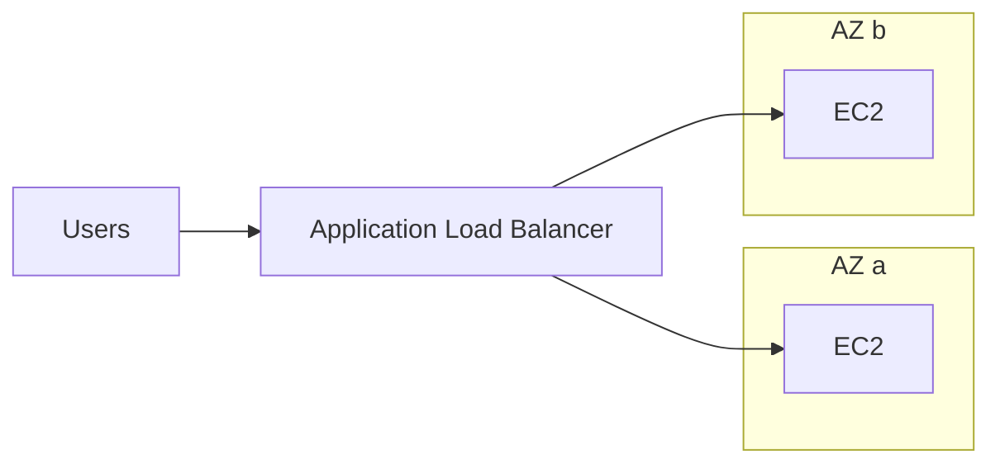

# Content authoring guide

Everything the site shows comes from this folder. Code lives in `src/`; nothing here is code.
Edit any file, save, and the dev server (`npm run dev`) reloads. Run `npm run validate`
after edits; it checks every rule below.

```
content/
  README.md            this guide
  course.json          course parts, section order, exam facts
  services.json        service catalog (ids used by the knowledge map)
  <section-id>/        one folder per section, e.g. 07-elb/
    meta.json          title, slide range, services, relations, sources
    lesson.md          the lesson (Markdown + Mermaid + callouts)
    flashcards.json    10–30 cards
    quiz.json          5–15 scenario questions
    labs/              0–3 labs, e.g. labs/01-alb-two-targets.md
```

## Ground rules

1. **Own words.** Rewrite every idea; never copy slide sentences or bullet lists verbatim.
   `npm run verbatim` flags any run of 10+ words shared with the slides. Short technical
   names ("Application Load Balancer", "gp3", "s3:GetObject") are fine.
2. **Original diagrams.** Draw architecture with Mermaid. Slide images are reference only;
   never embed or trace them as images.
3. **Accurate and current.** The slides are a snapshot. Check anything that changes over
   time (limits, quotas, prices, instance families, console wording, renamed / retired
   services, new features) on `docs.aws.amazon.com` (or `aws.amazon.com/<service>/pricing`
   and FAQs for prices). Then:
   - changed since the slides, or worth flagging as recent → an **Updated** marker with a short
     note on what changed;
   - could not confirm → a **Needs verification** marker saying what to check. Never guess.
   - list every page you checked in `meta.json` → `sources`.
4. **Exam focus.** SAA-C03 cares about choosing the right service for a scenario. Prefer
   "when to use / when not to use", trade-offs and limits over trivia.
5. **Concrete.** The learner is foundational-to-intermediate and learns from examples,
   diagrams, comparison tables and hands-on practice. Every abstract idea gets an example.

## `course.json`

Parts (sidebar groups) in course order, each listing its section ids, plus exam facts used by
the exam simulator (`questions`, `minutes`, `passScore`, `domains` with weights).

## `services.json`

`{ "services": [ { "id", "name", "category", "core", "summary" } ] }`.
`category` is one of: `compute`, `storage`, `database`, `networking`, `security`,
`integration`, `analytics`, `ml`, `management`, `migration`. `core: true` services show on the
default knowledge map; others appear when "Show all" is on. Section files must use these ids.
A service missing from the catalog can be declared in that section's `meta.json` →
`newServices` (same shape); it is merged into the catalog later.

## `meta.json`

```json
{
  "id": "07-elb",
  "order": 7,
  "title": "Elastic Load Balancing",
  "courseSection": "High Availability & Scalability",
  "slides": [118, 150],
  "estimatedMinutes": 35,
  "summary": "Two or three sentences shown on cards and in search.",
  "services": ["elb", "alb", "nlb", "gwlb", "ec2", "acm"],
  "relations": [
    { "from": "alb", "to": "ec2", "label": "routes HTTP/HTTPS to" },
    { "from": "acm", "to": "alb", "label": "provides TLS certificates for" }
  ],
  "examDomains": ["resilient", "performant"],
  "lastVerified": "2026-10-03",
  "sources": [
    { "title": "What is an Application Load Balancer?", "url": "https://docs.aws.amazon.com/elasticloadbalancing/latest/application/introduction.html" }
  ],
  "newServices": []
}
```

- `relations` feed the home knowledge map: 3–15 per section, `from`/`to` are service ids,
  `label` is a short verb phrase read as "from label to".
- `examDomains`: any of `secure`, `resilient`, `performant`, `cost`.

## `lesson.md`

Plain Markdown (GitHub flavour: tables, task lists, strikethrough) with these extras.

Required `##` headings, in this order, with topic sections between Key concepts and Exam tips:

```
## Summary
## Key concepts
## <topic sections…>        (use ## for topics, ### for sub-topics)
## Exam tips
## Common traps
```

- **Summary**: one short paragraph — what the services are for and when you would pick them.
- **Key concepts**: a bullet list of the 6–15 ideas to remember, one line each, terms in bold.
- **Topic sections**: explanations with examples. Use a comparison table whenever there are
  options (types, tiers, classes, policies, purchasing models, "X vs Y").
- **Exam tips**: `> [!EXAM]` callouts or a bullet list of exam signals
  ("keyword in the question → answer").
- **Common traps**: `> [!TRAP]` callouts or a bullet list of the distractors and misreadings
  that cost points.

### Callouts

GitHub-alert style blockquotes. The first line is `> [!TYPE]`, optionally followed by a title.

```md
> [!EXAM] Sticky sessions
> Questions about users "losing their cart" behind a load balancer point to sticky sessions
> or, better, moving session state to ElastiCache or DynamoDB.
```

| Type | Use for |
|---|---|
| `EXAM` | Exam tip: a signal in the question and the answer it points to |
| `TRAP` | Common trap: a tempting wrong answer and why it is wrong |
| `TIP` | Practical advice |
| `NOTE` | Side information |
| `EXAMPLE` | A worked example or mini scenario |
| `WARNING` | Risk of data loss, security exposure or cost |
| `UPDATED` | Content that differs from the slides (title = what changed) |
| `VERIFY` | Could not be confirmed on AWS docs (title = what to check) |
| `CHECK` | Labs only: what to observe / verify after a step |
| `COST` | Labs only: cost warning (required when the lab is not fully Free Tier) |

Inline markers for table cells or sentences: `{{updated: Max is now 15 minutes}}` and
`{{verify: Check the current per-Region quota}}`. They render as small badges with the note
as a tooltip.

### Diagrams

Fenced ` ```mermaid ` blocks. Put a caption on the first line as a Mermaid comment:

````md

````

- 2–6 diagrams per lesson (architecture, request flow, decision tree, lifecycle).
- Use `flowchart`, `sequenceDiagram`, `stateDiagram-v2`, `timeline` or `mindmap`.
- Quote labels that contain punctuation: `A["S3 (Standard-IA)"]`. Avoid `()` `[]` `{}` `;`
  `#` and `"` unquoted inside labels. Use `<br/>` for line breaks. Keep under ~25 nodes.
- The validator parses every diagram with Mermaid; a diagram that does not parse fails it.

## `flashcards.json`

```json
{
  "section": "07-elb",
  "cards": [
    {
      "id": "07-elb-fc-01",
      "front": "Which load balancer type works at layer 7 and routes by URL path or host header?",
      "back": "The **Application Load Balancer** (ALB).",
      "tags": ["alb"]
    }
  ]
}
```

- 10–30 cards. Ids `<section-id>-fc-NN`, unique, never reused for a different card (the learner's
  schedule is stored by id).
- One fact per card. Front is a question or prompt, back is a short answer (≤ 60 words).
  Markdown allowed. Mix definitions, "when would you use…", limits, and comparisons.
- Optional `"updated": "note"` or `"verify": "note"` adds the badge.

## `quiz.json`

```json
{
  "section": "07-elb",
  "questions": [
    {
      "id": "07-elb-q01",
      "type": "single",
      "domain": "resilient",
      "difficulty": "medium",
      "question": "A company runs a web app on EC2 instances in two AZs… Which solution meets these requirements?",
      "options": [
        { "id": "A", "text": "…", "correct": false, "explanation": "Why this is wrong for this scenario." },
        { "id": "B", "text": "…", "correct": true,  "explanation": "Why this is right." },
        { "id": "C", "text": "…", "correct": false, "explanation": "…" },
        { "id": "D", "text": "…", "correct": false, "explanation": "…" }
      ],
      "explanation": "The takeaway in one or two sentences.",
      "tags": ["alb", "health-checks"]
    }
  ]
}
```

- 5–15 questions in AWS exam style: a short scenario with a requirement ("most cost-effective",
  "least operational overhead", "highly available") and plausible distractors.
- `type: "single"`: exactly 4 options, exactly 1 `correct: true`.
- `type: "multi"`: 5 options with exactly 2 correct (question text ends with `(Select TWO.)`)
  or 6 options with exactly 3 correct (`(Select THREE.)`). At most a third of a section's
  questions are multi.
- Every option has an `explanation` saying why it is right or why it is wrong *for this
  scenario*. `explanation` at question level states the takeaway.
- `domain`: `secure` | `resilient` | `performant` | `cost`. `difficulty`: `easy` | `medium` | `hard`.
- Ids `<section-id>-qNN`, unique. Spread correct answers across A–D; do not always use B.
- Optional `"updated"` / `"verify"` notes as for flashcards.

## Labs: `labs/NN-slug.md`

YAML front matter, then Markdown. Add a lab whenever the topic can be practised in an account.

```md
---
id: 07-elb-lab-01
title: Put an Application Load Balancer in front of two EC2 instances
objective: Launch two web servers in different AZs and balance traffic across them with an ALB.
estimatedTime: 45 minutes
cost: "About USD 0.05 if deleted within an hour (ALB hourly + LCU); EC2 t3.micro covered by Free Tier credits."
freeTier: partial
services: [alb, ec2]
---
```

`freeTier`: `yes` (fully covered by Always Free or Free Tier credits), `partial`, or `no`.
For `partial` / `no`, add a `> [!COST]` callout at the top of the body explaining what is billed.

Free Tier wording (verified 2026-10): accounts created on or after 15 July 2025 get USD 100
in credits at sign-up (up to USD 100 more for activities) on a Free plan that lasts 6 months or
until credits run out; Always Free offers still apply. Accounts created before that date keep
the legacy 12-month Free Tier. Say "covered by Free Tier credits / Always Free" accordingly and
avoid promising "free" for anything billed hourly.

Required body headings:

```
## Prerequisites            bullet list (account, IAM permissions, CLI configured, Region…)
## Steps                    ### Step 1: … / ### Step 2: …
## Cleanup                  task list of EVERY resource created, in deletion order
## Progress checklist       task list: one item per step + cleanup done
```

Inside a step:

- Console instructions as a numbered list, using the current console labels in **bold**.
- AWS CLI equivalent where practical. Group the two as tabs with directives:

```md
:::console
1. Open the **EC2** console and choose **Load balancers** → **Create load balancer**.
:::

:::cli
```bash
aws elbv2 create-load-balancer --name demo-alb --subnets subnet-aaa subnet-bbb --security-groups sg-123
```
:::
```

- After key steps, a `> [!CHECK]` callout: what the learner should see.
- `- [ ]` task items anywhere in a lab become checkboxes saved in the browser.
- `## Cleanup` lists every resource with how to delete it (console + CLI), then a final
  check (e.g. Billing → Bills, or "no running instances in any Region you used").
